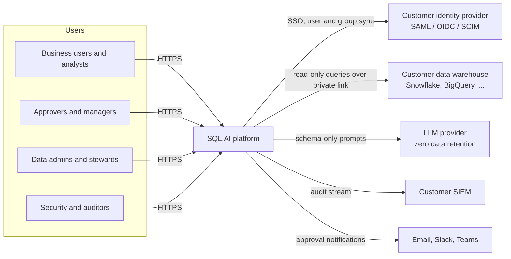
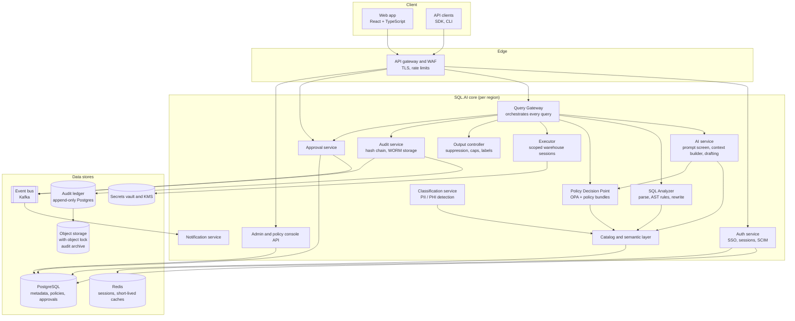
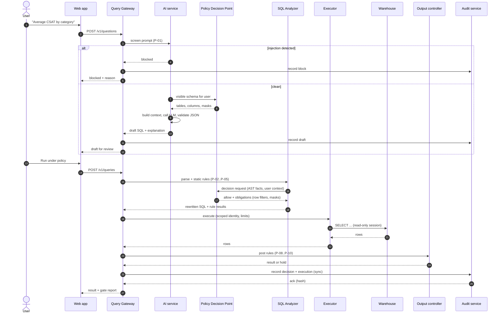
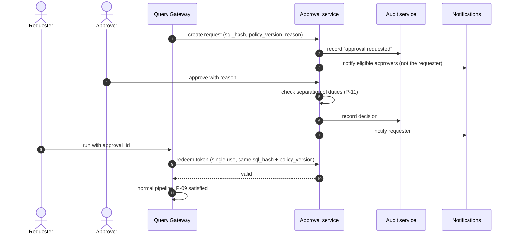
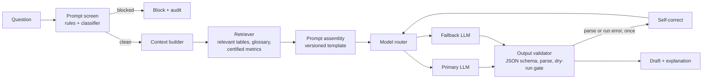
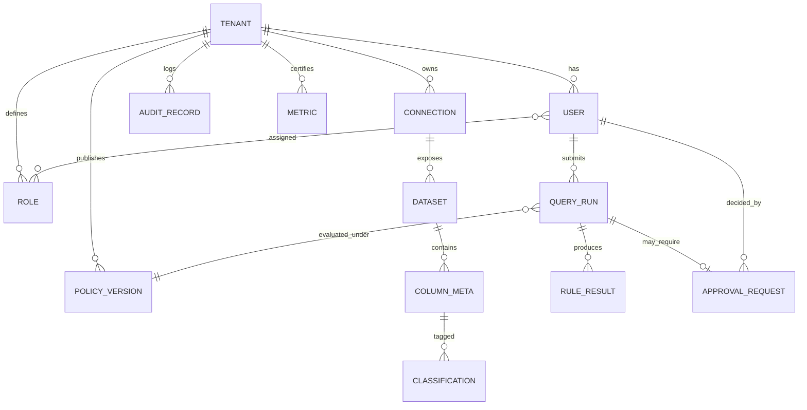
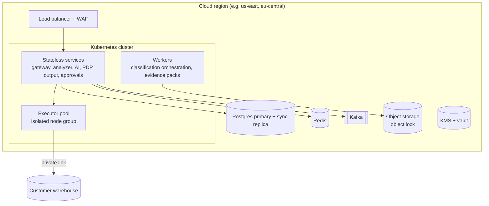

# SQL.AI — Model and Architecture

**Document type:** System architecture and model specification
**Version:** 1.1 (draft for review)
**Date:** 2026-10-14
**Owner:** [ENGINEERING LEAD NAME]
**Related:** PRD v1.0 (requirement IDs such as `GW-01` refer to it)

---

## Table of contents

1. Purpose and scope
2. Architecture principles
3. System context
4. Container view
5. Request lifecycle
6. Component design
7. Policy model
8. AI model architecture
9. Data model
10. Audit log design
11. Security architecture
12. Deployment architecture
13. Scalability and performance
14. Reliability and failure modes
15. Observability
16. Technology stack
17. Architecture decision records
18. Open technical questions

Diagrams use Mermaid and render on GitHub, GitLab and most Markdown viewers.

---

## 1. Purpose and scope

This document describes how SQL.AI is built: its components, data flows, data and policy models, AI architecture, security controls and deployment. It is the reference for engineers building the system and for security reviewers assessing it.

**In scope:** the multi-tenant SaaS product from Phase 1 to Phase 4 of the PRD.
**Out of scope:** the browser demo (`index.html`), which emulates the gate in the client for illustration only and is not a security boundary.

## 2. Architecture principles

| # | Principle | What it means in the design |
|---|---|---|
| A1 | **One gate** | Every query from every surface goes through the Query Gateway. No service other than the Gateway's executor holds warehouse credentials. |
| A2 | **Fail closed** | If policy, classification or audit is unavailable, the request is refused. |
| A3 | **Least privilege everywhere** | Queries run under a per-user scoped warehouse identity. Services get only the secrets they need. |
| A4 | **Data minimization** | The language model receives schema metadata, never row data. SQL.AI stores no customer rows except short-lived, erasure-aware caches. |
| A5 | **Defense in depth** | Policy is enforced on the SQL (static), in the data layer (row filters and masks) and on the output (post-checks). Bypassing one layer doesn't bypass the others. |
| A6 | **Evidence by construction** | The audit record is written in the same transaction path as the decision. No audit, no result. |
| A7 | **Policies as code** | Policies are versioned, tested and reviewed like software. |
| A8 | **Tenant isolation** | Every data store is partitioned by tenant; keys are per tenant. |

## 3. System context



**Trust boundaries:**
- Between users and SQL.AI (authenticated by the IdP).
- Between SQL.AI and the warehouse (private network, scoped credentials).
- Between SQL.AI and the LLM provider (schema metadata only; contractual zero retention).

## 4. Container view



| Container | Responsibility | PRD reqs |
|---|---|---|
| API gateway and WAF | TLS termination, auth token check, rate limits, request IDs | SEC-01 |
| Auth service | SAML/OIDC login, sessions, SCIM sync, role and attribute resolution | IAM-01–07 |
| Query Gateway | Orchestrates each query through screening, analysis, decision, execution, post-checks and audit | GW-01, GW-06 |
| SQL Analyzer | Parses SQL into an AST (multi-dialect), extracts tables and columns, runs static rules, rewrites for row filters and masks | GW-02–04, GW-07 |
| Policy Decision Point (PDP) | Evaluates policy bundles against the request context; returns decisions and obligations | POL-01–06 |
| Classification service | Detects sensitive columns inside the customer environment; proposes tags for steward review | PRV-01–02 |
| AI service | Prompt screening, schema-scoped context, model calls, output validation, self-correction | AI-01–10 |
| Executor | The only holder of warehouse credentials; opens a scoped session per request; enforces timeouts and cost limits | IAM-06, GW-05 |
| Output controller | Group-size suppression, disclosure budget, approval check, row caps, masking labels, export rules | PRV-05, PRV-10, PRV-12, OUT-01–05 |
| Approval service | Query and access requests, routing with fallback approver, previews, separation of duties, single-use tokens, expiry, invalidation on policy change, time-limited grants | APR-01–11, IAM-10 |
| Audit service | Hash-chained append-only ledger, WORM archive, verification, SIEM streaming, evidence packs | AUD-01–08 |
| Catalog and semantic layer | Schema cache, classifications, glossary, certified metrics | SEM-01–04, WB-05 |
| Admin console API | Connectors, policy authoring and review, access reviews | ADM-01–04 |

## 5. Request lifecycle

### 5.1 Natural-language question



**Key ordering guarantees:**
- The audit acknowledgement (step "ack") must arrive before the result is returned. If it fails, the result is discarded and the user sees an error (A6).
- When approval is required (P-09), results are discarded, not cached. The approved re-run executes again so the approver's decision is bound to a fresh execution.

### 5.2 Approval



## 6. Component design

### 6.1 Query Gateway

- Stateless service; one request = one **query context** object:

```json
{
  "request_id": "req_01J...",
  "tenant_id": "ten_...",
  "user": { "id": "usr_...", "roles": ["analyst"], "attrs": { "region": ["EU"] } },
  "policy_version": "pv_2026-10-14.3",
  "source": "ai_draft | editor | api | dashboard | schedule",
  "sql": "SELECT ...",
  "approval_id": null
}
```

- Pipeline stages are pure functions over the context plus side-effecting adapters (executor, audit). Each stage appends a `RuleResult` (`rule_id`, `state`, `detail`).
- A **pipeline invariant test** runs in CI: every API route that can reach the executor is exercised and must produce an audit record with a gate decision (`GW-01`).

### 6.2 SQL Analyzer

- Parses with a multi-dialect parser (sqlglot) into an AST.
- Extracts **facts** for the PDP: statement type, statement count, tables (fully qualified), columns per table, `SELECT *` usage, functions used, joins, aggregates, `LIMIT`.
- Static rules (P-02 to P-05) run on the AST, never on raw text. A regex prefilter exists only as a fast-fail.
- **Column lineage (PRV-09).** For every output column the analyzer records the source columns it derives from and whether each sits inside an aggregate. Aliases are resolved through CTEs and derived tables (`WITH a AS (SELECT full_name AS nm …) SELECT nm FROM a` resolves `nm → full_name`). The result drives three decisions:
  - *row-level personal data*: any output column whose lineage includes a PII or Restricted column **outside** an aggregate (this includes `GROUP BY full_name` with `full_name` in the output);
  - *count-like aggregates*: `COUNT(...)`, or `SUM` whose summed expression contains no column reference outside `CASE WHEN` conditions (for example `SUM(CASE WHEN … THEN 1 ELSE 0 END)`);
  - *mask labels*: output columns derived from masked columns are labelled, whatever they're called.
- **Aggregate-then-protect (PRV-11).** If every reference to a numeric column masked by rounding sits inside `AVG` or `SUM`, the data layer supplies true values for that query and the output is rounded (to $1k by default). `MIN`, `MAX` and row-level references keep the mask.
- **Cost estimate (GW-09, P-14).** Estimated work is the product of table sizes for cross or unconstrained joins, and the larger size for constrained joins; warehouses with `EXPLAIN` cost estimates use those instead. Queries over the role's limit are refused before execution.
- **Rewrite strategy** for obligations returned by the PDP:
  - Row filter: wrap each referenced table in a filtered subquery: `FROM (SELECT * FROM customers WHERE region IN ('EU')) AS customers`.
  - Mask: project the masked expression in the same subquery: `SELECT ..., mask_email(email) AS email ...`.
  - Where the warehouse supports native row access and masking policies (Snowflake, BigQuery), the analyzer instead attaches the user's scoped role, and native policies do the work. The rewrite remains as a second layer.
- Rewritten SQL is re-parsed and re-checked before execution.

### 6.3 Executor

- Only component with warehouse credentials (fetched from the vault per request, short-lived).
- Opens a session as the user's **scoped identity**: a per-user or per-role warehouse role that has only the grants the PDP allows (`IAM-06`).
- Sets `READ ONLY` transaction mode where supported, statement timeout and warehouse-side cost limits.
- Streams results to the output controller with a hard row ceiling (cap + 1, to detect truncation).

### 6.4 Output controller

- **Group-size suppression (PRV-12, P-08).** For any aggregate query the controller runs a companion count over the same scoped data: the query's `GROUP BY` expressions plus `COUNT(*)`, with ordering and limits removed. Each result row is matched to its group; every aggregate in a group with fewer than k rows (default 5) is suppressed, and count-like values below k become `"<k"`. A grouped query whose grouping columns aren't all in the output can't be checked and is refused.
- **Purpose (PRV-08, P-15).** Row-level personal data requires a purpose; high-risk purposes (default: marketing) always need approval.
- **Approval check (P-09).** If lineage shows row-level personal data and the row count exceeds the threshold, hold the result. Results are discarded, not cached.
- **Disclosure budget (PRV-10, P-13).** Each user has a rolling 24-hour count of personal-data rows returned, per data domain. A result that would push the total over the budget is held for approval. Approved runs count toward the budget but aren't held by it.
- Row cap (P-10) and labels for masked or suppressed cells.

### 6.5 AI service

Described in section 8.

### 6.6 Classification service

- Runs as a **customer-side job** (inside the customer's warehouse compute or a customer-hosted agent) so sampled values never leave their environment.
- Signals: column name patterns, data types, regex and checksum detectors (email, phone, national IDs, card numbers), value-distribution heuristics, and optionally an on-prem classifier model.
- Output: proposed tag and confidence per column. Unreviewed tags for sensitive classes are treated as confirmed for masking purposes (`PRV-02`).

### 6.7 Approval service

- Request record binds: `requester`, `sql_hash` (SHA-256 of normalized SQL), `policy_version`, `reason`, `row_estimate`, `columns`.
- Eligible approvers come from PDP policy (`approver_for` relations by data domain and management chain).
- Approval yields a **single-use token** valid for 72 hours (configurable).
- If no domain approver other than the requester exists, the security officer is the **fallback approver** (APR-10).
- Approvers with access to the data get a 3-row preview computed under the **requester's** scope and masks (APR-09); others decide on metadata.
- Publishing a new policy version invalidates outstanding approvals made under the old one (APR-11).
- **Access requests (IAM-10)** use the same workflow. Approval creates a grant record `{user, table, expires_at, granted_by}` (24 hours); while it's active the user's effective permissions include the table with every PII and Restricted column redacted and their own row filters kept.

### 6.8 Notifications and alerts

- Events (approval requested or decided, policy proposed or decided, scheduled run result, security alert) are published to the event bus and delivered in-app, by email and to Slack or Teams.
- **Security alerts (AUD-10)** are evaluated on each audit write per user over a 10-minute window: 4+ blocked actions, 2+ prompt-injection blocks, personal-data budget above 80%, any chain verification failure. Alerts are deduplicated per user and rule for 10 minutes, sent to the security team, and written to the audit log with outcome `alert`.
- **Scheduled reports (WB-11)** run as the owner, through the full gateway pipeline, under the policy version current at run time.

## 7. Policy model

### 7.1 Concepts

| Concept | Description |
|---|---|
| Principal | User with roles and attributes from the IdP |
| Resource | Warehouse, schema, table, column, each with classifications and owner |
| Action | `query`, `export`, `approve`, `admin.*` |
| Context | Source surface, time, approval token, purpose tag |
| Decision | `allow`, `allow_with_obligations`, `hold`, `deny` |
| Obligation | Row filter, mask, cap, suppression threshold, approval requirement |

### 7.2 Authoring format

Admins author policies in a YAML DSL in the console or a Git repository. They compile to Rego bundles for the PDP (OPA). Example:

```yaml
version: 2026-10-14.3
roles:
  analyst_eu:
    tables: [customers, orders, tickets]
    row_filter:
      region: { in: "$user.attrs.region" }
    masks:
      customers.full_name: initials
      customers.email: partial_email
      customers.phone: redact
  sales_manager_na:
    tables: [customers, orders, tickets]
    row_filter:
      region: { in: ["NA"] }
    masks:
      customers.phone: last4
    approver_for: [domain.customers]
  data_admin:
    tables: "*"
    masks:
      customers.email: partial_email
      customers.phone: last4
      employees.salary: round_10k
      employees.ssn: last4
    approver_for: [domain.customers, domain.people]

rules:
  small_group_threshold: 5
  approval:
    when:
      aggregate: false
      touches_classification: [PII, PHI, Restricted]
      rows_over: 25
  result_cap: 500
  select_star_on_sensitive: deny
```

Compiled Rego excerpt (illustrative):

```rego
package sqlai.query

default decision := {"effect": "deny", "reason": "no matching grant"}

decision := {"effect": "allow_with_obligations", "obligations": obligations} {
  every t in input.facts.tables { allowed_table(t) }
  not select_star_on_sensitive
  obligations := {
    "row_filters": row_filters,
    "masks": masks,
    "result_cap": data.rules.result_cap,
  }
}

allowed_table(t) {
  some r in input.user.roles
  t in data.roles[r].tables
}
```

### 7.3 Policy lifecycle

1. Author in console or Git.
2. Compile and run the **policy test suite** (golden queries with expected decisions) (`POL-03`).
3. Impact preview against the last 30 days of decisions (`POL-04`).
4. Second-admin approval (`POL-02`).
5. Publish as an immutable, signed bundle with a version ID; PDP instances hot-load it.
6. Every decision records the bundle version (`POL-06`). Rollback is publishing an earlier version (`POL-05`).

## 8. AI model architecture

### 8.1 Pipeline



### 8.2 Components

| Component | Design |
|---|---|
| **Prompt screen** | Two stages: deterministic patterns (instruction override, unmasking, system-prompt probing, encoded payloads) and a small classifier model hosted in-region. Either flag blocks. |
| **Context builder** | Requests the user's visible schema from the PDP. Hidden tables and columns are never named. Masked columns are described as masked. |
| **Retriever** | For large schemas: embeddings of table and column descriptions, glossary terms and certified metric definitions, stored per tenant in a vector index. Top-k results are filtered again by the user's visibility before use. |
| **Prompt template** | Versioned. Contains dialect rules, safety rules (single SELECT, no `*`, aliasing, date handling), visible schema and the output contract. |
| **Model router** | Chooses provider and tier per tenant policy (data residency, approved providers). Falls back on outage. Manual SQL keeps working if all models are down. |
| **Output validator** | Enforces the JSON contract `{sql, explanation}`, parses the SQL, and runs a dry gate check. A failure triggers one self-correction attempt with the error message, then stops (`AI-08`). |

### 8.3 Model requirements

- Provider terms: zero data retention, no training on customer data, regional endpoints (`AI-09`).
- No tools or execution ability are given to the model. It returns text only.
- Temperature low (≤ 0.2) for SQL generation; deterministic seeds where offered.
- Prompt and model versions are written to the audit record of each draft.

### 8.4 Evaluation

| Suite | Content | Gate |
|---|---|---|
| Accuracy benchmark | Question / gold SQL pairs per dialect over synthetic schemas; results compared by execution equivalence | ≥ 85% at GA |
| Refusal suite | Questions that need hidden tables or restricted data; model must decline without naming hidden objects | ≥ 99% correct refusals |
| Injection suite | Adversarial prompts (override, role-play, encoding, multi-turn, data-in-schema-comments) | 0 successful extractions (the gate must also block any that pass the model) |
| Regression | Previously fixed failures | 100% |

Evaluations run on every prompt, retriever or model change; results are stored with the version.

## 9. Data model

### 9.1 Entity relationship diagram



### 9.2 Key tables (PostgreSQL)

All tables carry `tenant_id` and use row-level security in Postgres keyed on the session's tenant.

```sql
CREATE TABLE users (
  id            text PRIMARY KEY,
  tenant_id     text NOT NULL,
  idp_subject   text NOT NULL,
  email         text NOT NULL,
  attrs         jsonb NOT NULL DEFAULT '{}',   -- region, department, clearance
  status        text NOT NULL CHECK (status IN ('active','suspended','deprovisioned')),
  created_at    timestamptz NOT NULL DEFAULT now(),
  UNIQUE (tenant_id, idp_subject)
);

CREATE TABLE policy_versions (
  id            text PRIMARY KEY,               -- e.g. pv_2026-10-14.3
  tenant_id     text NOT NULL,
  source_yaml   text NOT NULL,
  bundle_sha256 text NOT NULL,
  signed_by     text[] NOT NULL,                -- author + approving admin
  published_at  timestamptz,
  status        text NOT NULL CHECK (status IN ('draft','in_review','published','superseded'))
);

CREATE TABLE column_meta (
  id             text PRIMARY KEY,
  tenant_id      text NOT NULL,
  dataset_id     text NOT NULL,
  name           text NOT NULL,
  data_type      text NOT NULL,
  classification text NOT NULL CHECK (classification IN ('Public','Confidential','PII','PHI','Financial','Restricted')),
  class_source   text NOT NULL CHECK (class_source IN ('auto','steward')),
  confidence     numeric(4,3),
  reviewed_by    text,
  reviewed_at    timestamptz
);

CREATE TABLE query_runs (
  id              text PRIMARY KEY,             -- request_id
  tenant_id       text NOT NULL,
  user_id         text NOT NULL REFERENCES users(id),
  source          text NOT NULL,
  sql_original    text NOT NULL,
  sql_executed    text,                         -- after rewrite
  sql_hash        text NOT NULL,
  policy_version  text NOT NULL REFERENCES policy_versions(id),
  decision        text NOT NULL CHECK (decision IN ('allowed','modified','held','blocked','error')),
  row_count       integer,
  duration_ms     integer,
  approval_id     text,
  created_at      timestamptz NOT NULL DEFAULT now()
);

CREATE TABLE rule_results (
  query_run_id  text NOT NULL REFERENCES query_runs(id),
  rule_id       text NOT NULL,                  -- P-01 .. P-11
  state         text NOT NULL CHECK (state IN ('pass','applied','held','blocked')),
  detail        text NOT NULL,
  PRIMARY KEY (query_run_id, rule_id)
);

CREATE TABLE approval_requests (
  id              text PRIMARY KEY,
  tenant_id       text NOT NULL,
  requester_id    text NOT NULL REFERENCES users(id),
  sql_hash        text NOT NULL,
  policy_version  text NOT NULL,
  reason          text NOT NULL,
  status          text NOT NULL CHECK (status IN ('pending','approved','denied','expired','redeemed')),
  decided_by      text REFERENCES users(id),
  decision_note   text,
  expires_at      timestamptz NOT NULL,
  CHECK (decided_by IS NULL OR decided_by <> requester_id)   -- P-11 enforced in the schema too
);
```

## 10. Audit log design

### 10.1 Record format

```json
{
  "seq": 18234,
  "tenant_id": "ten_...",
  "ts": "2026-10-14T18:22:05.114Z",
  "actor": { "user_id": "usr_...", "ip": "203.0.113.4", "session": "ses_..." },
  "action": "query.executed",
  "outcome": "allowed",
  "request_id": "req_01J...",
  "policy_version": "pv_2026-10-14.3",
  "rules": [{ "id": "P-06", "state": "applied" }, { "id": "P-07", "state": "applied" }],
  "sql_hash": "9f2c...",
  "tables": ["orders"],
  "row_count": 3,
  "model": { "provider": "...", "model_version": "...", "prompt_version": "..." },
  "prev_hash": "a41b...",
  "hash": "c07e..."
}
```

`hash = SHA-256(canonical_json(record without hash))`, where the canonical form includes `prev_hash`. Each tenant has its own chain.

### 10.2 Storage and integrity

1. **Synchronous write** to an append-only Postgres ledger (no `UPDATE` or `DELETE` grants; enforced by triggers and role grants). A replicated commit is required before acknowledgement.
2. **Checkpointing:** every 5 minutes, a Merkle root over new records is computed, signed with a tenant-specific KMS key and written to object storage with **object lock (compliance mode)** for the retention period.
3. **Verification:** on demand and hourly, the chain and checkpoints are recomputed; a mismatch raises a critical alert (`AUD-04`).
4. **Streaming:** records are published to Kafka after commit for SIEM delivery and notifications (at-least-once; consumers deduplicate on `seq`).
5. **Erasure vs immutability:** audit records store hashes of SQL text and identifiers rather than personal values where possible. Where personal data must be logged, it is encrypted with a per-subject key; erasure deletes the key (crypto-shredding) without breaking the chain.

## 11. Security architecture

### 11.1 Threat model summary (STRIDE)

| Threat | Example | Controls |
|---|---|---|
| Spoofing | Stolen session | SSO + MFA, short sessions, device and IP binding for admin actions |
| Tampering | Altering audit records | Append-only ledger, hash chain, signed checkpoints in WORM storage |
| Repudiation | "I never approved that" | Approver identity, reason and hash in the chain |
| Information disclosure | Prompt injection to reveal hidden data | Schema-only context, gate on all SQL, data-layer masks, output post-checks |
| Denial of service | Expensive queries | Cost estimates, per-role limits, rate limits, warehouse resource monitors |
| Elevation of privilege | Bypassing the gateway via a new endpoint | Executor is the only credential holder; pipeline invariant tests; network policy blocks other services from the warehouse |

### 11.2 Controls

- **Network:** private link or VPC peering to warehouses; egress allowlists per service; Kubernetes network policies so only the executor can reach warehouse endpoints.
- **Secrets:** vault with dynamic, short-lived credentials; no secrets in images, env files or logs.
- **Encryption:** TLS 1.2+ (1.3 preferred) everywhere; AES-256 at rest; per-tenant data keys wrapped by KMS; customer-managed keys for Enterprise.
- **Supply chain:** signed images, SBOMs, dependency scanning, pinned base images, two-person review for production deploys.
- **Admin access:** no standing production access; just-in-time access with approval and session recording.

## 12. Deployment architecture



- **Regions:** each region is self-contained (data, logs, keys) to support residency (`PRV-07`). Tenants are pinned to a region.
- **Tenancy tiers:**
  - *Standard:* shared clusters, logical isolation (tenant IDs, Postgres RLS, per-tenant keys).
  - *Enterprise:* dedicated executor pool and database, customer-managed keys.
  - *Regulated (future):* single-tenant deployment in the customer's cloud account.
- **Releases:** GitOps; canary deploys per region; automatic rollback on SLO burn.

## 13. Scalability and performance

| Concern | Approach |
|---|---|
| Gate latency (p95 < 300 ms) | In-memory policy bundles in PDP sidecars; cached schema per tenant; AST parsing in-process |
| Concurrency (1,000 concurrent queries per tenant) | Executor pool autoscaling; per-tenant concurrency quotas; warehouse does the heavy lifting |
| AI latency | Retriever narrows schema; streaming responses; quick-tier model for screening |
| Large schemas (10,000+ tables) | Vector retrieval of relevant tables; visibility filtering after retrieval |
| Result caching | Keyed by `(tenant, user_scope_hash, policy_version, sql_hash)`; TTL minutes; purged on erasure |

## 14. Reliability and failure modes

| Failure | Behavior |
|---|---|
| PDP unavailable | Deny all queries (fail closed); show "policy service unavailable" |
| Audit ledger unavailable | Deny all queries; results never returned without an audit ack |
| LLM provider down | Fall back to secondary model; if none, AI drafting disabled; editor still works |
| Classification job stale | Columns with expired scans keep their last tags; new columns default to masked |
| Warehouse slow | Timeouts per role; user sees a timeout and the run is logged |
| Kafka down | Ledger and WORM still written; SIEM streaming catches up from the ledger |

**SLOs:** availability 99.9%; gate p95 < 300 ms; audit write p95 < 150 ms; RPO 15 minutes (application data), 0 (audit ledger); RTO 4 hours.

## 15. Observability

- OpenTelemetry traces across all services, keyed by `request_id`, the same ID used in the audit record.
- Metrics: decisions by rule and outcome, false-block reports, gate latency, AI latency and refusal rate, approval wait time, chain verification results.
- Logs are structured JSON and never contain result rows, unmasked values or prompts beyond what the audit design allows.
- Alerts: chain verification failure (critical), fail-closed events, spikes in blocked injection attempts, executor errors.

## 16. Technology stack

| Layer | Choice | Reason |
|---|---|---|
| Frontend | React, TypeScript, Vite | Mature ecosystem, typed |
| API and services | Python 3.12 (FastAPI) for analyzer and AI; Go for gateway edge and executor | sqlglot for multi-dialect SQL; Go for low-latency I/O |
| SQL parsing | sqlglot | Multi-dialect AST, transpilation, rewrite support |
| Policy engine | Open Policy Agent (Rego bundles) | Proven, sidecar deploy, decision logs |
| Metadata store | PostgreSQL 16 | Relational integrity, RLS |
| Cache and sessions | Redis | Low latency |
| Event bus | Kafka | Durable streaming to SIEM |
| Audit archive | Object storage with object lock | WORM retention |
| Secrets and keys | HashiCorp Vault, cloud KMS | Dynamic credentials, envelope encryption |
| Runtime | Kubernetes, Helm, Argo CD | GitOps, isolation |
| Observability | OpenTelemetry, Prometheus, Grafana | Open standards |
| CI/CD | GitHub Actions, Sigstore signing | Supply-chain integrity |

## 17. Architecture decision records

| ADR | Decision | Status | Alternatives considered |
|---|---|---|---|
| ADR-001 | Single Query Gateway for all surfaces | Accepted | Per-surface checks (rejected: bypass risk) |
| ADR-002 | AST-based analysis with sqlglot, regex only as prefilter | Accepted | Regex-only (rejected: evasion), warehouse EXPLAIN only (rejected: dialect gaps) |
| ADR-003 | Defense in depth: rewrite + warehouse-native policies + output checks | Accepted | Native policies only (rejected: not all warehouses support them) |
| ADR-004 | OPA/Rego for decisions, YAML DSL for authoring | Accepted | Cedar (strong option; revisit), custom engine (rejected) |
| ADR-005 | Schema-only LLM context, no tools for the model | Accepted | Agentic model with execution tool (rejected: bypass risk) |
| ADR-006 | Synchronous audit before returning results | Accepted | Async logging (rejected: evidence gaps) |
| ADR-007 | Classification runs customer-side | Accepted | Vendor-side sampling (rejected: data leaves customer) |
| ADR-008 | Crypto-shredding for erasure in audit data | Proposed | Redaction in place (rejected: breaks chain) |
| ADR-009 | Lineage-based classification of output columns | Accepted | Column-name matching (rejected: bypassed by aliases and GROUP BY, found in the 1.0 audit) |
| ADR-010 | Group-size suppression with a companion count query | Accepted | Count-column name heuristics (rejected: bypassed by renaming); differential privacy (deferred as an optional mode) |
| ADR-011 | Rolling per-user disclosure budget | Accepted | Per-query thresholds only (rejected: bypassed by paging) |

## 18. Open technical questions

1. Per-user vs per-role warehouse identities: per-user is most precise but harder to manage at scale. Proposal: per-role with session attributes, per-user for Enterprise.
2. Cedar vs OPA long term, given Cedar's analyzability for policy verification.
3. Approver preview: can approvers see a masked sample of held results without weakening P-09?
4. Self-hosted deployment timing for regulated customers.
5. Benchmark data: building realistic synthetic schemas per industry without using customer data.

---

*Next: Developer Manual.*
